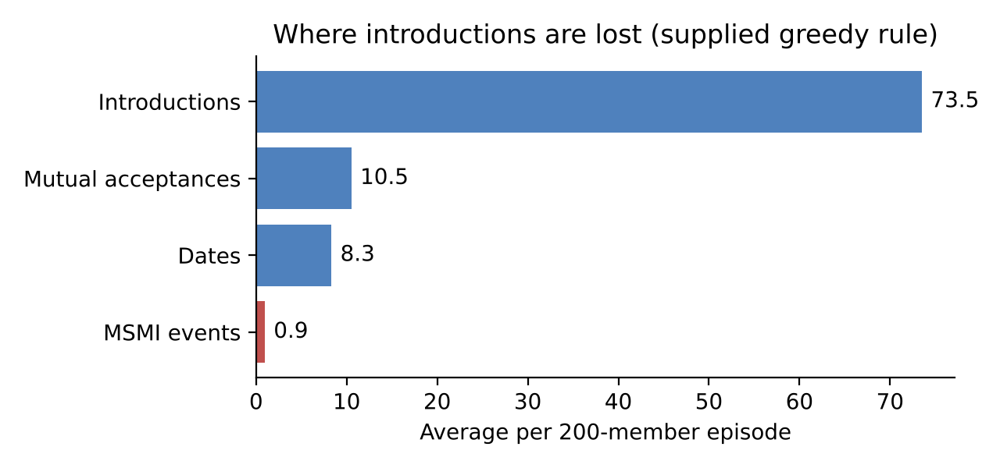
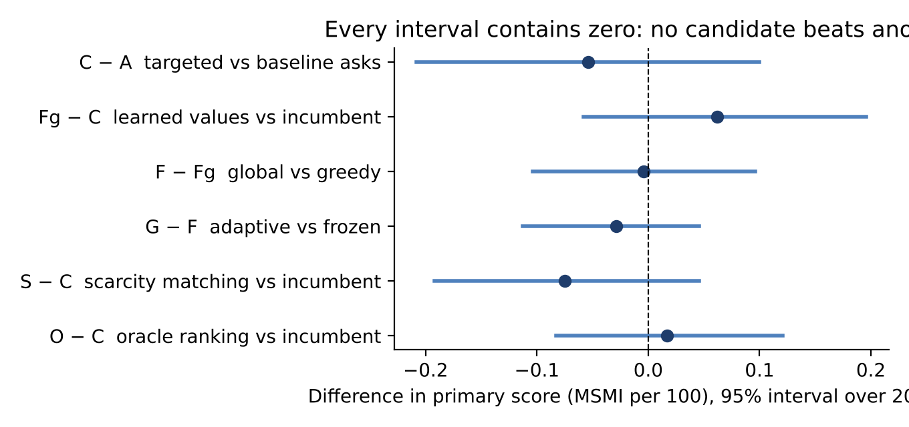
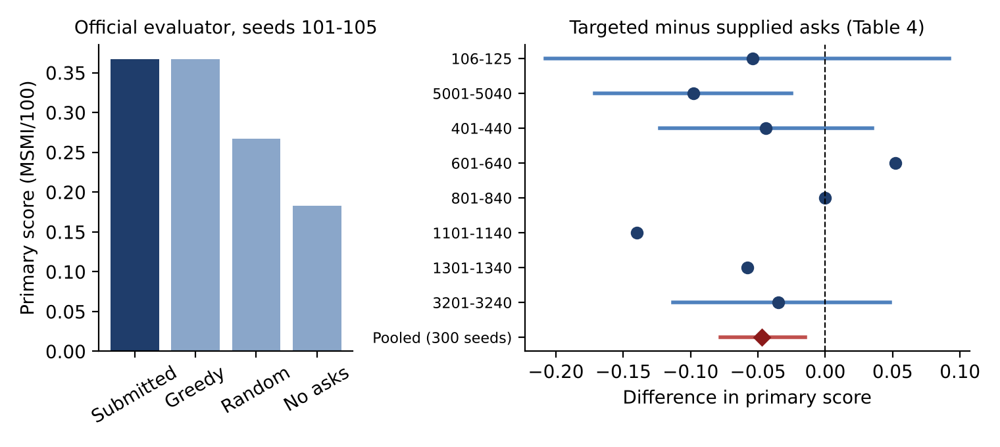

# Technical report: a sequential matching policy under uncertainty

**Team:** Danpotatoes: Dan George (roll no. 25f3001550) and Pranav Mesta (roll no. 24f1002540). **Repository:** https://github.com/24f1002540/sequential-matching-policy
**Release:** participant kit 1.0.0 (synthetic data only). **Submitted version:** see the commit SHA in the Final submission issue.

## 1. Summary

We submit a deterministic policy that applies the **supplied clarification and similarity-greedy rules inside an independent validity guard**: reciprocal feasibility from the supplied eligibility rules, the supplied hard-constraint clarification rule, the supplied greedy matcher, and a guard that re-checks every ask and pair. It needs no learned asset, no network and no random numbers.

This is the result of our research, not a shortcut. Over two rounds we tested a targeted clarification rule, learned edge values, global and scarcity-weighted matching, online adaptation, and (through eleven further studies by a team member) value-of-information asking, soft-field asking, deadline-aware and robust selection, exploration, graph allocation, response-history and Bayesian predictors, reciprocal and opportunity-cost allocation, and deliberate waiting. **None beat the supplied rules on the primary score.** One of them, our own targeted-asking rule, looked slightly better on five exploratory seeds and was our Round 2 candidate; on 40 fresh seeds chosen for that purpose it scored lower than the supplied asking rule (-0.098 MSMI per 100 [-0.171, -0.025]), and pooled with every other fresh paired block it was lower by -0.047 [-0.078, -0.015] (Section 5.7). A pre-written decision rule therefore switched the submission to the supplied asking rule.

* **The score is supply-bound.** An episode contains about 100 pairs that are ever feasible and about 80% are introduced, so allocation and ranking rules have little to choose between (Section 5.1, 5.3).
* **Clarification is essential** (no-clarification: coverage 0.14 against about 0.35).
* **Observable data barely predicts acceptance** (held-out AUC 0.51 to 0.57 across several models), so there is nothing reliable to rank on, and even perfect pair-quality knowledge would add only about 7% (Section 5.3).
* **Validity is the decisive risk:** one invalid assessed episode makes an entry ineligible. The contribution of this submission beyond the supplied rules is the guard, fuzz, scale and regression tests, a decision trace, a reproducible evaluation, and the evidence in this report.

## 2. Problem and assumptions

The policy runs for 60 decision days on a changing population of 200 synthetic members. Each day it makes two calls: an *ask* call
(clarification requests within 12 units; the hard-constraint bundle costs 3, a soft field 1) and a *match* call (disjoint feasible pairs,
possibly none). It observes only the request JSON: arrived members, field values with statuses (observed, not asked, declined) and
observation days, past introductions and delayed feedback, and its own `memory`.

The primary score is mutual second-meeting intentions (MSMI) per 100 arrived members: both members accept the introduction, a date happens
within 30 days of assignment, and both return Yes to a second meeting within 3 days of the date. The score is the equal-weight mean over six
scenario families. Ties are broken by coverage, then mutual acceptances per 100, then lower clarification cost, then lower inference time.

Assumptions we rely on, each checked against the public kit documentation: (i) `null` means unknown, never zero or rejection; (ii) a declined
field stays unavailable, so asking again is wasted budget and matching on it is prohibited; (iii) hard constraints are reciprocal and must
be satisfied in both directions; (iv) the hidden outcome process, response propensities and seeds are never observable, and the policy never
tries to reconstruct them.

## 3. Method

1. **Reciprocal feasibility.** The supplied `eligibility(a, b)` is applied in both directions. A known hard failure excludes the pair; a
   missing hard field makes it `needs_clarification`; only `feasible` pairs can be introduced. Soft fields never override hard rules.
2. **Clarification.** The supplied rule: members who are available, have at least one unknown hard-constraint field and have declined none are asked the
   3-unit hard-constraint bundle, in list order, until fewer than 3 units of the day's 12-unit budget remain. Members who declined a hard field are never asked
   again. (Our earlier candidate ranked members by how many otherwise-open pairs their answer could unlock; it is kept as `mode='targeted'` in `policy.py`
   for the record and scored lower, Section 5.7.)
3. **Allocation.** The supplied greedy matcher scores each feasible pair by the number of soft fields on which both known values agree and
   takes disjoint pairs in descending order. The default is to fill: an introduction costs nothing directly, and our supply analysis shows
   members are rarely idle with an option, so waiting rules have little room to help.
4. **Guard.** An independent check re-validates every ask (member exists and is available, valid field, no duplicate, within budget) and every
   pair (both available, feasible, not repeated, no reuse in the batch) and returns the empty action on any exception.
5. **Memory.** None is needed: every call recomputes decisions from the full observable state, which keeps the policy restart-safe and
   far below the 1 MiB limit.

We did not use a learned probability model in the submission. Our held-out checks (Section 5.2) showed only a weak first-stage signal
(AUC 0.575) and no usable second-meeting signal (AUC 0.52), and models gave no detectable gain in the full simulator.

## 4. Experimental design

* **Simulator and seeds.** All experiments use the public simulator (episodes of 200 members, 60 decision days, 40 follow-up days) across the six scenario families. Round 1 used exploratory seeds 101 to 105 and confirmatory seeds 106 to 125. Round 2 adds fresh seeds 201 to 240 for the adoption test, seeds 5001 to 5040 for the final selection test (Section 5.7), and the official evaluator on seeds 101 to 115 for the final results. Team-member studies used further seed pools (401 to 3240) and are reported as recorded summaries (Sections 5.6 and 5.7). Training seeds (1000 to 1007) and validation seeds (2000 to 2002) were used only for the learned-model checks and are separate from all evaluation seeds.
* **Paired comparisons.** Every policy runs on identical seeds and variants. Intervals are 95% percentile-bootstrap intervals that resample *seeds* (each seed contributes its six family results together), which is more conservative than resampling episodes.
* **Pre-specification.** The first four contrasts (K1 to K4) were written down before any confirmatory episode ran; later ones are dated addenda (`PRESPEC.txt`). The pre-specification files carry no externally verifiable timestamp: both entered the repository's history together with the results they describe, so their timing is self-attested. They specify intervals that resample episodes, whereas the reported intervals resample seeds, which is more conservative; we changed this deliberately and say so here. The Round 2 adoption rule for the candidate upgrade was written before any seed-201-to-240 episode ran (`PRESPEC_R2.txt`), and the final selection rule (keep targeted asks or switch to the supplied asks) was written before any seed-5001-to-5040 episode ran (`PRESPEC_R3.txt`).
* **Faithfulness.** In-process runs of the supplied baselines reproduced the supplied evaluator exactly on the episodes we compared, and our policy was run through the official JSON subprocess protocol for every result in Section 6.

## 5. Evidence behind the design

### 5.1 The score is supply-bound

On 24 episodes (seeds 106 to 109, six families) we tracked which pairs were ever feasible among available members and which were introduced. On average 100.2 pairs are ever feasible per episode, 80.3 (80%) are introduced, and an offline supply bound (every non-declined constraint known) is 113.3, so clarification already reaches 88% of what could be feasible. On a typical day only about 2.7 feasible pairs exist among 200 members, and members sit idle with an available option on 0.49% of member-days. On average 32% of members (range 27% to 47%) decline at least one hard field and can never be introduced. The funnel is also thin: of 8,822 introductions by the supplied baseline over 120 confirmatory episodes, 14.3% became mutual acceptances, 79% of those led to a date, and 11% of dates produced a mutual second-meeting Yes (113 MSMI events, about 0.9 per episode). 43% of episodes score zero.

*Figure 1. Average funnel per 200-member episode for the supplied greedy rule, which is the submitted policy's decision rule (Round 1 confirmatory seeds): about 74 introductions yield about 10.5 mutual acceptances, 8 dates and 0.94 MSMI events.*

### 5.2 Candidate comparison (Round 1 confirmatory seeds 106 to 125)

Arms: A supplied baseline asks plus greedy; C targeted hard asks plus supplied greedy (our Round 1 and Round 2 candidate, later replaced by A, Section 5.7); Fg learned edge values plus soft asks, greedy; F the same with global maximum-weight matching; G F plus online adaptation; S targeted asks plus scarcity-weighted maximum-cardinality matching; O an offline oracle ranking (a bound, not a policy).

**Table 1. Confirmatory summary (20 seeds, 120 episodes per policy).**

| Policy | Primary score (MSMI/100) | Coverage | Mutual acc. /100 | Ask cost | Introductions | Mutual acc. | Dates | MSMI events | Zero-MSMI episodes |
|---|---|---|---|---|---|---|---|---|---|
| A  baseline asks + supplied greedy (supplied; now submitted) | 0.471 | 0.338 | 5.27 | 200 | 73.5 | 10.5 | 8.3 | 113 | 51 / 120 |
| C  targeted asks + supplied greedy (earlier candidate) | 0.417 | 0.338 | 5.45 | 197 | 74.3 | 10.9 | 8.2 | 100 | 58 / 120 |
| Fg learned values + soft asks, greedy | 0.479 | 0.337 | 5.40 | 241 | 73.9 | 10.8 | 8.2 | 115 | 52 / 120 |
| F  learned values + soft asks, global | 0.475 | 0.338 | 5.70 | 239 | 73.4 | 11.4 | 9.1 | 114 | 53 / 120 |
| G  F + online adaptation | 0.446 | 0.339 | 5.55 | 239 | 74.1 | 11.1 | 8.6 | 107 | 53 / 120 |
| S  targeted asks + scarcity-weighted matching | 0.342 | 0.340 | 5.53 | 197 | 75.6 | 11.1 | 8.3 | 82 | 69 / 120 |
| O  oracle ranking (offline bound, not a policy) | 0.433 | 0.337 | 5.58 | 197 | 73.6 | 11.2 | 8.7 | 104 | 59 / 120 |

*Figure 2. Paired differences in primary score (Table 2). Every interval includes zero.*

**Table 2. Confirmatory contrasts (first minus second; 20 seeds; MSMI events per episode, the primary score is 0.5 times this).**

| Contrast (first minus second) | Test | Mutual acceptances per episode | MSMI events per episode | Primary score (MSMI/100) | Seeds |
|---|---|---|---|---|---|
| C − A  targeted vs baseline asks | K1, K2 | +0.36 [-0.38, +1.18] | -0.11 [-0.42, +0.19] | -0.054 [-0.208, +0.100] | 20 |
| Fg − C  learned values + soft asks vs incumbent | K3 | -0.10 [-0.71, +0.49] | +0.12 [-0.12, +0.39] | +0.062 [-0.058, +0.196] | 20 |
| F − Fg  global vs greedy, same learned values | K5 | +0.60 [+0.07, +1.11] | -0.01 [-0.20, +0.19] | -0.004 [-0.104, +0.096] | 20 |
| G − F  adaptive vs frozen | K6 | -0.30 [-0.68, +0.07] | -0.06 [-0.23, +0.09] | -0.029 [-0.113, +0.046] | 20 |
| S − C  scarcity-weighted matching vs incumbent | K10, K11 | +0.17 [-0.67, +0.83] | -0.15 [-0.38, +0.09] | -0.075 [-0.192, +0.046] | 20 |
| O − C  oracle ranking vs incumbent (bound) | K9 | +0.26 [-0.42, +0.89] | +0.03 [-0.17, +0.24] | +0.017 [-0.083, +0.121] | 20 |

*Reading.* No contrast on the primary score excludes zero. Targeted asks reduce clarification cost by 3.3 units per episode (interval [-4.2, -2.5], cheaper in 20 of 20 seeds) with no detectable change in outcomes on these 20 seeds (later seeds show a lower score for the targeted rule, Section 5.7). Global matching raises mutual acceptances (+0.60) and dates (+0.83) but not MSMI. Online adaptation slightly lowers dates (-0.48 [-0.82, -0.13]). An earlier 5-seed result that targeted asks beat the baseline on MSMI did not replicate on 20 fresh seeds (pooled over 25 seeds: -0.03 events [-0.30, +0.24]), and we withdrew it. Fresh seeds then pointed the other way (Section 5.7).

**Clarification is essential** (exploratory seeds 101 to 105): with no clarification, mutual acceptances fall by 6.40 per episode [-8.37, -4.47] and MSMI events by 0.37 [-0.53, -0.20], and coverage drops from about 0.35 to 0.14.

**Learned models.** Training on 2,863 randomised-among-feasible rollout introductions, the first-stage model reached AUC 0.575 on held-out rollouts (Brier 0.2315 against 0.2355 for a constant), but the second-meeting model was uninformative (AUC 0.520; Brier 0.0748 against 0.0745) with 333 training dates, and learned values gave no detectable MSMI gain (Fg minus C: +0.12 [-0.12, +0.39]). On the static data, a similarity model scored AUC 0.465 on held-out directional responses and member history AUC 0.510 [0.458, 0.561], that is, no usable signal. We therefore ship no learned asset.

### 5.3 Headroom

An offline expected-outcome measure (simulator true probabilities summed over the pairs a policy introduced; evaluation only, 36 episodes per policy) gives expected MSMI per episode of 0.836 (A), 0.826 (C), 0.860 (Fg), 0.859 (S) and 0.882 for the oracle O. The oracle exceeds C by only +6.8% [-0.5%, +14.2%]. Even perfect knowledge of pair quality adds about 7%, which a 20-seed evaluation cannot resolve: per-seed primary-score standard deviations are 0.28 to 0.33, giving a minimum detectable difference of about 0.22 MSMI/100 at 20 seeds per family (0.157 at 40, 0.099 at 100) against scores near 0.45.

### 5.4 Round 2 adoption test (hypothesis-driven ablation of the allocation rule)

*Hypothesis (H-S).* Scarcity-weighted matching, which prefers pairs that use members with few feasible partners, raises throughput and therefore MSMI over the supplied greedy rule, with the same clarification policy. *Pre-registered rule* (`PRESPEC_R2.txt`, seeds 201 to 240, 240 episodes per arm): adopt only if introductions rise with a lower bound above zero, MSMI events do not fall by more than 0.10 per episode (lower bound), mutual acceptances do not fall, and ask cost does not rise by more than 1 unit.

**Table 3. Scarcity matching (S) against the submitted policy (C), 40 fresh seeds.**

| Measure (per episode) | S | C | S minus C [95% interval over seeds] |
|---|---|---|---|
| Introductions | 73.59 | 73.35 | +0.24 [-0.85, +1.33] |
| Mutual acceptances | 10.87 | 10.75 | +0.12 [-0.44, +0.73] |
| Dates | 8.60 | 8.48 | +0.11 [-0.41, +0.69] |
| MSMI events | 0.717 | 0.725 | -0.008 [-0.154, +0.133] |
| Coverage | 0.332 | 0.331 | +0.001 [0.000, +0.002] |
| Ask cost (units) | 192.5 | 192.5 | -0.01 [-0.10, +0.09] |

*Result.* The introduction and MSMI conditions failed (lower bounds -0.85 and -0.154), so S was **not adopted**. The hypothesis is not supported: throughput did not rise. This matches the supply analysis. With so few feasible pairs per day, allocation has almost nothing to rearrange.

### 5.5 Clarification ordering: why we did not test further tweaks

The daily clarification budget (4 hard-constraint bundles) binds on some days: in a diagnostic on 6 episodes (seeds 201 and 202, standard, cold start and delayed families), 83 of 360 days had more askable members than budget, although total spending (about 195 of 720 units per episode) shows the backlog drains later. We therefore tried an alternative ordering, *pair completion* (greedy marginal credit that favours finishing pairs by choosing partners together). On 120 days of two episodes it selected a different member set on only 5 days (4%), and on the one episode we ran fully it produced identical results to the targeted rule. An effect that rarely changes any action cannot be resolved with the seeds we can afford, so we did not run a confirmatory test and kept the simpler rule (this section predates, and is superseded by, the switch to the supplied asking rule in Section 5.7). This is a diagnostic, not a pre-specified comparison (`experiments/diag_budget.py`, `experiments/diag_t.py`, `experiments/t_arm.py`).

### 5.6 Further exploratory studies (eleven additional alternatives, none adopted)

After the Round 2 adoption test (section 5.4), one team member ran eleven further studies on fresh seed pools to see whether any alternative to our then-candidate policy (C, targeted asks plus supplied greedy) would raise MSMI. Each study had pre-declared adoption gates, and several were stopped at a validation or mechanism gate instead of being run to full confirmation. None cleared its gate, so none replaced the candidate. Note that these studies compare against C, not against the supplied asking rule, which Section 5.7 shows scores higher than C. These are recorded summaries of those runs; they have not been independently re-run for this report.

| Study | Idea | Seeds (x 6 families) | Main result (paired difference vs C unless stated) | Outcome |
|---|---|---|---|---|
| 1 | Order hard-constraint questions by estimated decision value | 401-440 | -0.015 [-0.098, +0.069] | Not adopted |
| 2 | Also ask soft fields (residual / mixed) | 601-640 | +0.000 [-0.046, +0.048]; ask cost rose from 194.8 to 258.4; mixed variant -0.031 | Not adopted |
| 3 | Prefer pairs under deadline pressure | 801-840 | +0.013 [-0.029, +0.058] | Not adopted |
| 4 | Exploration bonus in pair ranking | 1101-1140 | +0.017 [-0.033, +0.067]; the two bonus sizes gave identical results | Not adopted |
| 5 | Scenario-robust selector | 1301-1340 | +0.027 [-0.042, +0.104] | Not adopted |
| 6 | Failure funnel, and can acceptance be predicted from observable data? | 1,200 diagnostic episodes | Prediction gate failed (mutual-acceptance AUC 0.568 [0.491, 0.628], Brier tied with prevalence) | Policy kept |
| 7 | Member-level response-history model | 1609-1612 | Combined AUC 0.532 [0.508, 0.551]; Brier worse than prevalence | Stopped at validation |
| 8 | Reciprocal-proposal allocation | 1801-1804 | Pair set differed on 1 of 1,080 match-days (0.09%; gate was 5%) | Stopped at mechanism gate |
| 9 | Opportunity-cost allocation (reorder, and withhold) | 2001-2006 | Reordering changed 1.16% of days (gate 5%); withholding changed 44.6% of days but scored 0.153 against 0.389 | Reorder stopped; withholding vetoed |
| 10 | Rank questions by how much reachable feasible-pair supply they add | 2301-2320 | -0.008 [-0.071, +0.050]; cold-start family about -0.125; fewer ask units (-2.83) | Stopped at validation |
| 11 | Lexicographic maximum-cardinality matching (then maximum weight) instead of greedy | screening set | +0.007 [-0.035, +0.063]; changed 6.1% of match-days (two other graph variants changed under 2% and were stopped) | Not adopted |

Differences are in primary-score units (MSMI per 100 arrived members) with 95% intervals over seeds. Absolute scores from different seed pools should not be compared with each other; only the paired differences within one study mean anything (the same policy scored between 0.32 and 0.45 across these pools).

A second set of reports repeated studies 1, 7 and 9 on different seeds with the same conclusions (for example, a Bayesian pair-outcome estimator reached combined held-out AUC 0.535 [0.470, 0.582] with a Brier score worse than prevalence, against a pre-declared lower bound of 0.55; and waiting rules cut introductions to about a third and the score from 0.958 to 0.167 on a development set).

Three results matter beyond "nothing worked".
- **Study 10 shows why more feasible supply does not help.** The new questions changed what was asked on 74.4% of eligible days and produced extra feasible pairs on 67.7% of those days, yet MSMI did not rise. The loss is later in the funnel (section 6.2).
- **Studies 8 and 9 show that allocation has little room.** With only 2 to 3 feasible pairs per day among about 100 available members, two members rarely compete for the same partner, so a smarter allocation rule seldom chooses a different set of pairs. The one rule that did change behaviour a lot (withholding) cut introductions by 58% and lowered the score.
- **Studies 6 and 7 are consistent with the headroom estimate in section 5.3.** A truth-informed ranking was estimated to add only about 0.04 MSMI per 100 (about 0.083 events per episode), and observable features predicted acceptance barely better than chance.

These studies do not prove that no better policy exists. They show that the eleven alternatives we tried did not meet pre-declared adoption criteria in this simulator.

Where the data is: the per-episode outputs of these studies are not part of this repository; the table gives the recorded summaries, and we make no claim that readers can reproduce them from the files here.

### 5.7 Final selection test: targeted asks against the supplied asking rule

*Why we ran it.* Nearly every team-member study that included both the supplied baseline and our targeted candidate (C) showed C a little below the baseline (A) on the primary score, although each interval alone included zero. Because the two differ only in which members receive the clarification bundle, and because the ask-cost saving of C is worth nothing in the ranking (cost is only the fourth tie-break), we asked whether C should be kept at all.

*Pre-specified rule* (`PRESPEC_R3.txt`, written before any seed-5001-to-5040 episode ran; self-attested timing). Seeds 5001 to 5040, six families, arms A and C, identical worlds. Switch to the supplied asks if and only if (1) C minus A is negative on these seeds, and (2) the pooled difference over all fresh paired blocks has an upper 95% bound below zero.

**Table 4. Fresh paired blocks, C (targeted asks) minus A (supplied asks), primary score (MSMI per 100).**

| Seeds (6 families each) | Source | Seeds | C minus A |
|---|---|---|---|
| 106 to 125 | this repository (`experiments/results/conf_*.jsonl`) | 20 | -0.054 [-0.208, +0.092] |
| 5001 to 5040 | this repository (`experiments/results/r3_*.jsonl`) | 40 | **-0.098 [-0.171, -0.025]** |
| 401 to 440 | team-member study, recorded summary | 40 | -0.044 [-0.123, +0.035] |
| 601 to 640 | team-member study, recorded summary | 40 | +0.052 |
| 801 to 840 | team-member study, recorded summary | 40 | 0.000 |
| 1101 to 1140 | team-member study, recorded summary | 40 | -0.140 |
| 1301 to 1340 | team-member study, recorded summary | 40 | -0.058 |
| 3201 to 3240 | team-member study, recorded summary | 40 | -0.035 [-0.113, +0.048] |
| **Pooled** | all of the above | 300 | **-0.047 [-0.078, -0.015]** |

On seeds 5001 to 5040 the point estimate was negative (C worse on 24 seeds, better on 12, equal on 4), and the pooled upper bound was below zero, so both conditions held and the submission uses the supplied asks. The pooled interval is a normal approximation that treats each team-member block as 40 seeds at its recorded mean and uses the per-seed standard deviation of the difference measured in our own blocks (0.277); without the largest gap (seeds 1101 to 1140) the pooled difference is -0.032. The five exploratory seeds 101 to 105, where C looked better (+0.150), are left out of the pool because they are the seeds on which C was first selected.

**Table 5. Funnel measures on seeds 5001 to 5040 (per episode; 240 episodes per arm).**

| Measure | A (supplied asks) | C (targeted asks) | C minus A [95% interval over seeds] |
|---|---|---|---|
| Introductions | 72.76 | 73.85 | +1.09 [+0.22, +1.97] |
| Mutual acceptances | 10.47 | 10.27 | -0.20 [-0.77, +0.37] |
| Dates | 8.26 | 8.21 | -0.05 [-0.61, +0.48] |
| MSMI events | 0.75 | 0.55 | -0.20 [-0.35, -0.05] |
| Ask cost (units) | 195.55 | 192.47 | -3.08 [-3.88, -2.36] |

Primary score: A 0.375, C 0.277; zero-MSMI episodes: A 123 of 240, C 142 of 240. C introduces slightly more pairs but converts them to MSMI less often; mutual acceptances and dates are not detectably different, so the loss shows up only at the rare final stage. We do not have a demonstrated mechanism. One possibility is that spending the clarification budget on the members who unlock the most pairs front-loads introductions that are individually less promising, but that is a conjecture, not something we tested.

*Caveats.* This is one pre-specified test plus a pooled estimate; the team-member blocks are recorded summaries, not files in this repository; and the decision was made after seeing earlier blocks (which is why the rule and seed set were fixed beforehand). The effect, about 0.05 MSMI per 100 on average, is small next to the 0.22 difference a 20-seed evaluation can resolve, so the practical value of the switch is a modest shift in expected rank, not a guaranteed gain. The supplied rule is also what every baseline-level entry runs, so this submission should be read as "at least as good as the supplied rule, with a validity guard", not as a better method.

## 6. Final evaluation through the official evaluator

The submitted policy and the three supplied baselines were run with the official `evaluate.py` protocol (a separate process per call, 1 MiB and 10 s limits checked), on seeds 101 to 105 and all six scenario families (30 episodes per policy). All 120 episodes were valid. Raw results: `results/final.json`, `results/baseline_greedy.json`, `results/baseline_no_asks.json`, `results/baseline_random.json`.

**Read this section with Section 5.** The submitted policy makes the same decisions as the supplied greedy baseline (the supplied clarification and matching rules behind the guard), so on these seeds its results are identical to the baseline's episode by episode: all 30 action digests are equal (`compare_results.py`; the only difference is a few per-call milliseconds for the guard). The comparisons that carry information here are therefore the other two: **clarification matters** (no-clarification scores lowest on every measure that depends on feasible pairs) and the policy is far from random-feasible only in the clarification it performs, not in its allocation. Seeds 101 to 105 are also the exploratory seeds on which our earlier targeted rule first looked better; that result is superseded by Section 5.7.

**Table A. Primary score and ranking measures (official evaluator output, seeds 101 to 105, 30 episodes per policy).** The first two rows have identical decisions; they differ only in measured inference time.

| Policy | Valid episodes | Primary score (MSMI/100) | Coverage | Mutual acc. /100 | Ask cost | Mean inference s/episode | MSMI events |
|---|---|---|---|---|---|---|---|
| Submitted policy | 30 / 30 | 0.367 | 0.353 | 5.18 | 197 | 14.7 | 22 |
| Supplied greedy baseline | 30 / 30 | 0.367 | 0.353 | 5.18 | 197 | 22.8 | 22 |
| Supplied no-clarification | 30 / 30 | 0.183 | 0.137 | 1.98 | 0 | 24.1 | 11 |
| Supplied random-feasible | 30 / 30 | 0.267 | 0.356 | 5.08 | 197 | 22.5 | 16 |

**Table A2. Paired differences in primary score, submitted policy minus each supplied baseline (seeds 101 to 105; 95% interval resampling the five seeds).**

| Comparison | Difference (MSMI/100) | 95% interval | Seeds where submitted is better |
|---|---|---|---|
| Submitted minus supplied greedy | 0.000 | [0.000, 0.000] | 0 of 5 (identical decisions) |
| Submitted minus supplied no-clarification | +0.183 | [+0.100, +0.267] | 5 of 5 |
| Submitted minus supplied random-feasible | +0.100 | [-0.183, +0.350] | 3 of 5 |

The only difference that excludes zero is the one against no clarification; five seeds cannot resolve the gap to random-feasible.

*Figure 3. Left: Table A scores (the submitted policy and the supplied greedy baseline are the same decisions). Right: every fresh paired block comparing our earlier targeted asks with the supplied asks (Table 4); intervals are shown where recorded, and the pooled interval excludes zero.*

**Table B. Scenario-level outcomes (means per episode).**

| Scenario family | Policy | Introductions | Mutual acc. | Dates | MSMI events | Coverage | Mean of per-episode median first wait (days) | Unserved members | Missing feedback | Ask cost |
|---|---|---|---|---|---|---|---|---|---|---|
| standard | Submitted policy | 91.8 | 12.4 | 9.6 | 1.00 | 0.403 | 3.8 | 119.4 | 53.6 | 188 |
| standard | Supplied greedy baseline | 91.8 | 12.4 | 9.6 | 1.00 | 0.403 | 3.8 | 119.4 | 53.6 | 188 |
| standard | Supplied no-clarification | 30.4 | 5.2 | 4.2 | 0.60 | 0.172 | 0.0 | 165.6 | 18.0 | 0 |
| standard | Supplied random-feasible | 92.8 | 11.4 | 9.8 | 0.60 | 0.409 | 4.2 | 118.2 | 50.0 | 188 |
| sparse geography | Submitted policy | 18.0 | 3.6 | 3.0 | 0.20 | 0.139 | 3.4 | 172.2 | 8.6 | 184 |
| sparse geography | Supplied greedy baseline | 18.0 | 3.6 | 3.0 | 0.20 | 0.139 | 3.4 | 172.2 | 8.6 | 184 |
| sparse geography | Supplied no-clarification | 5.4 | 0.8 | 0.8 | 0.00 | 0.045 | 1.4 | 191.0 | 2.0 | 0 |
| sparse geography | Supplied random-feasible | 18.0 | 3.4 | 2.8 | 0.20 | 0.139 | 3.5 | 172.2 | 8.6 | 184 |
| cold start | Submitted policy | 79.8 | 10.4 | 9.0 | 0.80 | 0.370 | 6.1 | 126.0 | 42.8 | 246 |
| cold start | Supplied greedy baseline | 79.8 | 10.4 | 9.0 | 0.80 | 0.370 | 6.1 | 126.0 | 42.8 | 246 |
| cold start | Supplied no-clarification | 15.4 | 2.0 | 1.6 | 0.20 | 0.091 | 0.0 | 181.8 | 8.4 | 0 |
| cold start | Supplied random-feasible | 78.8 | 11.0 | 10.0 | 0.40 | 0.368 | 6.6 | 126.4 | 45.6 | 246 |
| delayed dates | Submitted policy | 90.0 | 12.2 | 9.8 | 0.60 | 0.402 | 3.7 | 119.6 | 51.6 | 188 |
| delayed dates | Supplied greedy baseline | 90.0 | 12.2 | 9.8 | 0.60 | 0.402 | 3.7 | 119.6 | 51.6 | 188 |
| delayed dates | Supplied no-clarification | 30.0 | 5.6 | 4.2 | 0.40 | 0.172 | 0.0 | 165.6 | 17.2 | 0 |
| delayed dates | Supplied random-feasible | 90.6 | 12.8 | 10.2 | 0.60 | 0.408 | 4.2 | 118.4 | 47.2 | 188 |
| shifted weights | Submitted policy | 93.0 | 11.8 | 9.4 | 0.80 | 0.404 | 3.7 | 119.2 | 52.8 | 188 |
| shifted weights | Supplied greedy baseline | 93.0 | 11.8 | 9.4 | 0.80 | 0.404 | 3.7 | 119.2 | 52.8 | 188 |
| shifted weights | Supplied no-clarification | 31.2 | 5.0 | 4.2 | 0.40 | 0.173 | 0.0 | 165.4 | 18.4 | 0 |
| shifted weights | Supplied random-feasible | 93.0 | 11.6 | 9.0 | 0.80 | 0.406 | 4.0 | 118.8 | 48.2 | 188 |
| changing conditions | Submitted policy | 92.4 | 11.8 | 9.0 | 1.00 | 0.403 | 3.8 | 119.4 | 53.6 | 188 |
| changing conditions | Supplied greedy baseline | 92.4 | 11.8 | 9.0 | 1.00 | 0.403 | 3.8 | 119.4 | 53.6 | 188 |
| changing conditions | Supplied no-clarification | 30.4 | 5.2 | 4.2 | 0.60 | 0.172 | 0.0 | 165.6 | 18.0 | 0 |
| changing conditions | Supplied random-feasible | 93.0 | 10.8 | 9.2 | 0.60 | 0.409 | 4.2 | 118.2 | 49.8 | 188 |

*Reading.* The submitted policy produced no invalid episode, and its slowest episode used 16.2 s of inference across 120 calls (the per-call limit is 10 s). Per-episode inference time (14.7 s here against 22.8 s in the baseline file, which was run at a different time under different machine load) differs by machine load more than by policy; both are far below the limits, and the guard adds a small per-call cost that matters only for the last tie-break. Ask cost is identical to the baseline's because the clarification rule is the same.

### 6.1 Further validity, decision trace and robustness checks

* **Wider official-protocol run.** The submitted policy was run through the unmodified evaluator protocol on ten further seeds (106 to 115, six families, 60 episodes; `results/validity_a.json`, `results/validity_b.json`). All 60 episodes were valid; the slowest took 15.9 s of inference over 120 calls (mean 14.7 s). The primary score on these seeds was 0.442 (53 MSMI events), coverage 0.337 and ask cost 200.6. Scores on different seed blocks swing by this much (Section 7), which is why we make no superiority claim.
* **Fuzzing (`test_fuzz.py`).** States from simulated episodes were mutated (blank or declined fields, unavailable members, empty or tiny populations, odd budgets, duplicated introductions, shuffled order) and requests with missing or malformed fields were sent. The policy returned a valid action every time, and these requests produced an empty valid action instead of an error. Input that is not a JSON object at all (never sent by the official harness) ends the process with an error.
* **Scale (`test_scale.py`).** Populations of 200 and 400 members over 20 days: slowest single call 0.13 s and 0.33 s, responses under 3 KiB. Requests grow over an episode (the log of past questions is cumulative): over full 60-day, 200-member episodes the largest request we measured was about 0.49 MB, so the harness's own 1 MiB limit leaves roughly a 2x margin at 200 members and would be reached at roughly 400 members, long before the 10 s limit would matter for this policy.
* **Decision trace (`explain.py`, `explain_episode.py`).** For every ask the trace records the member, field, cost, credit and the pairs the answer could unlock; for every introduction it records the agreeing soft fields, the similarity score and the member's remaining options. `test_explain.py` confirms the trace never changes a decision (identical actions with and without it).

### 6.2 Failure analysis

This subsection covers the failure modes the problem statement asks us to explain. Numbers come from Table B, section 5.1 and the studies in section 5.6.

**Sparse supply.** In the sparse-geography family the submitted policy made about 18 introductions per episode (against 75 to 90 in other families), coverage was 0.139 and 172 of 200 members were never served (Table B). Supply, not policy choice, is the limit: every policy we tested, including the supplied baselines, is equally starved there.

**Withheld answers (declined fields).** About 32% of members decline at least one hard field and can never be introduced (section 5.1). An offline diagnostic on 24 fresh episodes, which used hidden truth for measurement only, estimated that 51% to 68% of pairs that were in the world at the same time were permanently blocked by declined hard fields. Of the remaining pairs that were truly feasible, 75% to 99% were already introduced, so clarification is close to the supply ceiling.

**Where introductions fail.** Across 1,200 diagnostic episodes the targeted candidate (C; the supplied rule behaves almost identically at this level, Table 1) made 77.6 introductions per episode, 14.6% reached mutual acceptance, 77.6% of those led to a date and 8.7% of dates led to a mutual second-meeting Yes (0.77 events per episode; 46% of episodes scored zero). In a stage attribution of 1,738 introductions, 85.6% failed before mutual acceptance (about 78% of those by an explicit decline and 22% because feedback was missing), 2.8% failed between acceptance and the date, and about 10% failed at the second meeting. Acceptance is the bottleneck, and the observable features we tried could not predict it (studies 6 and 7).

**Delayed feedback and delayed dates.** The policy does not use feedback, so late feedback cannot make it act on stale information. The question is whether the scoring windows cut off outcomes. In the stage attribution, the 30-day date window bound in 0.0% to 0.2% of cases, so the delayed-dates family is not a meaningful loss source for this policy. Scores in the delayed-dates family were close to the standard family (Table B), and the deadline-aware matcher (study 3) gave no reliable gain. The 30-day window is a property of the scoring rule, so a date that happens late can in principle miss it; we only claim that it was rarely the binding loss in the attributed sample.

**Cold start.** Cold-start episodes need more clarification (ask cost about 241 against about 187 elsewhere in Table B) and had a higher median wait for a first introduction (5.0 days against about 2.9). The only policy change that touched this family, study 10, made it worse (about -0.125), which is why it was not adopted.

**Competition for the same candidate.** Members sit idle while they have a feasible option on only 0.49% of member-days (section 5.1), and with 2 to 3 feasible pairs per day the matcher rarely has to choose between two pairs that share a member. Reciprocal and opportunity-cost allocation changed the chosen pairs on 0.09% and 1.16% of days (studies 8 and 9), so competition for a candidate is real but too rare to be worth designing for.

**Censoring and missing feedback.** Missing feedback is large (about 40 to 52 members per episode in Table B). We handled it in three ways: the policy never reads feedback, so censored outcomes cannot bias its decisions; diagnostics counted a missing response as "no mutual acceptance", not as a rejection of any individual member; and the learned-model studies used labels taken only after the follow-up period, so unfinished outcomes were not treated as failures.

## 7. Limitations

* **Public worlds only.** The six public scenario families approximate, but are not, the private worlds. Effects that vanish here could appear there and vice versa.
* **Noise.** About one MSMI event occurs per 200-member episode. A 20-seed-per-family evaluation resolves differences of about 0.22 MSMI per 100 against a score near 0.45, so ranking among competent policies is largely chance. We therefore do not claim that our policy outperforms the baseline on the primary score.
* **The submission is the supplied rule.** Its decisions equal the supplied greedy baseline's, so it is not expected to rank above baseline-level entries; its advantages are the validity guard, the tests and trace, and the reproducible evidence. Our research found nothing that beat the supplied rules on the primary score, and Section 5.7's switch from our own targeted asks rests on one pre-specified test plus a pooled estimate that includes recorded summaries of team-member runs.
* **Selective labels.** Outcomes exist only for the pairs we introduce, and propensities are null in the supplied logs, so we make no inverse-propensity claims and compare complete policies on identical seeds instead.
* **Offline analyses use simulator internals** (the supply bound, the oracle ranking and the expected-outcome measure) for bounding and variance reduction only. No submitted policy reads them, and no policy parameter was fitted to them.
* **Exploratory against confirmatory.** Only K1 to K4, the Round 2 adoption rule and the final selection rule (`PRESPEC_R3.txt`) were specified before their confirmatory runs. Later contrasts are labelled and are less strictly confirmatory. We did not adjust for multiple comparisons.
* **Container check.** The authoring sandbox had no Docker daemon, so the container build and the offline container evaluation (`evaluate.py --image`, seed 101) were verified on GitHub Actions for the public repository: both the organisers' `verify.yml` workflow (tests on Python 3.10 and 3.12, data verification, local and container evaluation) and our `container-check.yml` workflow passed on the final submitted commit (see the Actions tab for that SHA; an earlier commit failed because our Dockerfile copied a file that the supplied `.dockerignore` excluded; we restored the supplied Dockerfile). `container-check.yml` runs all six scenario families for seed 101 through the container (six episodes), not every assessed episode.
* **Synthetic only.** Nothing here estimates real-world compatibility or relationship outcomes. A real service would need an adapter, validation on authorised data, current constraint checks and human review.

## 8. Reproducibility

All commands are in the README, and `bash run_all.sh` runs the tests, scale check and official-protocol evaluation in one step; `make_figures.py` redraws the figures from the numbers printed here. The submitted policy is deterministic (no random numbers; ties are broken by member identifier) and has no training seeds. Experiment scripts record seeds and variants; raw per-episode results are under `results/` and `experiments/`. The pre-specification files (`PRESPEC.txt`, `PRESPEC_R2.txt`) are included with their dates.

## 9. Provenance and tools

Only the public kit was used; no external data or paid services. Inside the image: Python standard library only. Offline experiment scripts additionally use NumPy, NetworkX and scikit-learn (all BSD-3-Clause), run on a single CPU core. AI assistants (Claude, Anthropic) were used by both team members: one assistant read the repository, wrote and ran the experiments and the policy code, and drafted the Round 1 note, the code and this report; the further studies in Section 5.6 were run by the other team member with an assistant. The team chose the problem track, directed the work and its scope, supplied the repository and accounts, and is responsible for the submission; the team's own review of individual results is not claimed beyond that. The team retains ownership of its work; this report grants no commercial licence.
